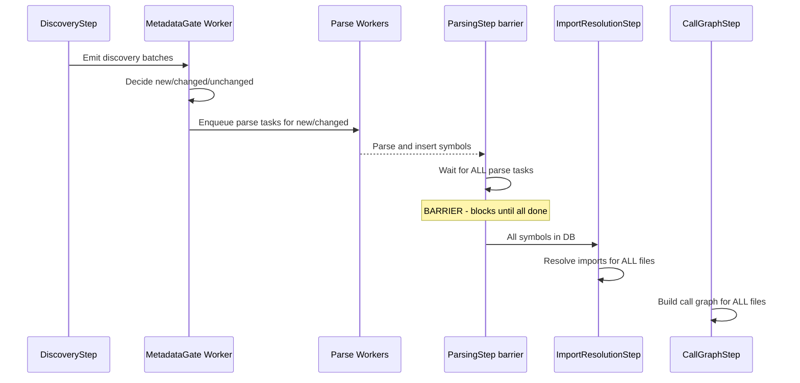

# Early-Exit Safety Analysis for Unchanged Reruns

## Problem Statement

The performance report shows that unchanged reruns take ~38s, with:
- `CallGraphStep`: 29.8s (78% of time) creating 20,646 relationships
- `ImportResolutionStep`: 5.9s (16% of time) creating 0 relationships

Both steps run on ALL files regardless of whether any files changed. We need to determine what's safe to skip.

## Streaming Mode Timing Analysis

### Current Pipeline Flow



### Key Question: Are all symbols available when ImportResolutionStep runs?

**Answer: YES** - The `ParsingStep._wait_for_streaming_parse_tasks()` acts as a barrier:

1. Discovery emits all batches
2. Metadata gate processes each batch, enqueues parse tasks for new/changed files
3. `ParsingStep` collects ALL parse task IDs from all batches
4. `ParsingStep._wait_for_streaming_parse_tasks()` polls until ALL tasks complete
5. Only then does `ImportResolutionStep` run

**Evidence from code**:
- [`parsing_step.py:186-211`](axon-src/src/workers/pipeline/steps/parsing_step.py:186) - `_wait_for_streaming_parse_tasks()` waits for all task IDs
- [`parsing_step.py:222-259`](axon-src/src/workers/pipeline/steps/parsing_step.py:222) - Polls until all tasks in READY_STATES
- [`sync_worker.py:318`](axon-src/src/workers/sync_worker.py:318) - `ImportResolutionStep` depends on `ParsingStep`

### What about unchanged files?

Unchanged files already have their symbols in DB from the previous run:
- Metadata gate marks them as `unchanged` or `unchanged_hash`
- No parse task is enqueued for them
- Their symbols remain in DB unchanged
- ImportResolutionStep can still resolve imports to them

### What about cross-batch imports?

Example: File A in batch 1 imports from File B in batch 2
- Both files are discovered before ParsingStep barrier
- Both parse tasks (if needed) are enqueued before barrier
- Barrier waits for ALL tasks from ALL batches
- ImportResolutionStep runs only after barrier completes

**Conclusion**: The streaming design correctly handles timing. All symbols are in DB when ImportResolutionStep runs.

### CallGraphStep

**What it does**: Creates `CALLS` and `USES` relationships between symbols.

**Data flow**:
1. Query all methods/functions in repository from DB
2. For each file, parse source code and extract calls
3. Resolve call targets by name/type lookup in DB
4. Create `Relation(from_symbol_id, to_symbol_id, CALLS/USES)`

**Dependencies**:
| Factor | Source | Target | Impact |
|--------|--------|--------|--------|
| Caller code changes | Changed file | N/A | Calls FROM this file may change |
| Callee signature changes | N/A | Changed file | Calls TO this file may need re-resolution |
| New symbols added | N/A | Changed file | Unchanged files can't call new symbols (code didn't change) |

**Key insight**: A call relationship is defined by the **caller's source code**. If file A didn't change:
- A's source code is identical
- A's calls are identical
- A's call relationships are already correct in DB

**Transitive effects?**
- If file B changed and added method `foo()`, file A (unchanged) cannot call `foo()` because A's source code didn't change
- If file B changed and renamed method `bar()` to `baz()`, A's call to `bar()` becomes stale - but this is a data quality issue, not something re-running would fix (A still calls `bar()` in its source)

**Conclusion for CallGraphStep**: 
- ✅ **Safe to skip entirely for unchanged files**
- Only need to process files that changed
- Existing relationships from unchanged files remain valid

### ImportResolutionStep

**What it does**: Creates `IMPORTS` relationships between symbols based on import statements.

**Data flow**:
1. Query all files in repository
2. For each file, parse import statements
3. Resolve imports to target files and symbols
4. Create `Relation(from_symbol_id, to_symbol_id, IMPORTS)`

**Dependencies**:
| Factor | Source | Target | Impact |
|--------|--------|--------|--------|
| Import statements change | Changed file | N/A | Imports FROM this file may change |
| Exported symbols change | N/A | Changed file | Imports TO this file may resolve differently |

**Key insight**: Import resolution has a **bidirectional dependency**:
- File A's imports depend on A's source code (unchanged → imports unchanged)
- File A's import resolution depends on what symbols exist in target files (may change!)

**Example scenario**:
```
File A (unchanged): import { UserService } from './services';
File B (changed): Added export for UserService (previously didn't exist)
```
- A's import statement didn't change
- But A's import resolution now succeeds (previously failed)
- A's IMPORTS relationship changes even though A didn't change

**Conclusion for ImportResolutionStep**:
- ⚠️ **NOT safe to skip entirely**
- Need to re-resolve imports that target changed files
- Can skip re-resolution for imports targeting unchanged files

## Proposed Implementation

### CallGraphStep Early-Exit

```python
async def execute(self, ctx: PipelineContext) -> None:
    # Early exit if no files changed
    changed_file_ids = ctx.metadata.get("changed_file_ids", [])
    if not changed_file_ids:
        logger.info("call_graph_skipped_no_changes", repository_id=ctx.repository_id)
        # Emit skip metric
        streaming_stage_items_total.labels(
            stage="call_graph",
            item_type="files",
            result="skipped"
        ).inc(total_files)
        return
    
    # Process only changed files
    # ... existing logic with file_id filter
```

**Implementation approach**:
1. Check `changed_file_ids` from context
2. If empty, skip entirely
3. If present, filter query to only process those files
4. Delete existing relationships FROM changed files before rebuilding

### ImportResolutionStep Selective Processing

```python
async def execute(self, ctx: PipelineContext) -> None:
    changed_file_ids = set(ctx.metadata.get("changed_file_ids", []))
    
    if not changed_file_ids:
        # No files changed - can skip entirely
        logger.info("import_resolution_skipped_no_changes", repository_id=ctx.repository_id)
        return
    
    # Get files that import from changed files
    affected_file_ids = await self._get_files_importing_from(changed_file_ids)
    
    # Process only affected files + changed files
    files_to_process = changed_file_ids | affected_file_ids
    
    # ... existing logic with file filter
```

**Implementation approach**:
1. Track `changed_file_ids` from metadata gate
2. Query which files import from changed files
3. Only re-resolve imports for affected files
4. Delete existing IMPORTS relationships for processed files before rebuilding

## Required Data Tracking

To implement selective processing, we need:

1. **`changed_file_ids`**: List of file IDs that changed (from metadata gate)
   - Already tracked as `parse_file_ids` in context
   - Need to propagate to downstream steps

2. **Import dependency map**: Which files import from which files
   - Can query from existing `IMPORTS` relationships
   - Or build on-demand from file paths

## Risk Assessment

| Risk | Likelihood | Impact | Mitigation |
|------|------------|--------|------------|
| Stale call relationships to renamed symbols | Low | Medium | Accept; would require full re-index to detect |
| Missing import relationships after target changes | Medium | High | Re-resolve imports targeting changed files |
| Duplicate relationships | Medium | High | Delete before rebuild; use unique constraints |

## Recommended Next Steps

1. **Phase 1**: Implement CallGraphStep early-exit (safe, high impact)
    - Add `changed_file_ids` check
    - Filter processing to changed files only
    - Delete existing relationships from changed files first

2. **Phase 2**: Implement ImportResolutionStep selective processing
    - Query files importing from changed files
    - Re-resolve only affected imports
    - More complex but necessary for correctness

3. **Phase 3**: Add relationship cleanup logic
    - Ensure old relationships are deleted before rebuild
    - Consider unique constraints to prevent duplicates

## Implementation Status

### ✅ Phase 1: CallGraphStep Early-Exit (COMPLETED)

**Files modified:**
- [`call_graph_step.py`](axon-src/src/workers/pipeline/steps/call_graph_step.py) - Added early-exit logic when `parse_file_ids` is empty
- [`call_graph_builder.py`](axon-src/src/extractors/call_graph_builder.py) - Added `changed_file_ids` parameter and selective processing

**Implementation:**
1. Check `ctx.metadata["parse_file_ids"]` at start of `CallGraphStep.execute()`
2. If empty in streaming mode, skip entirely with skip metrics
3. If non-empty, pass to `CallGraphBuilder.build_call_relationships()`
4. Builder filters query to only changed files
5. Builder deletes existing CALLS/USES relationships from changed files before rebuilding

### ✅ Phase 2: ImportResolutionStep Early-Exit (COMPLETED)

**Files modified:**
- [`import_resolution_step.py`](axon-src/src/workers/pipeline/steps/import_resolution_step.py) - Added early-exit logic when `parse_file_ids` is empty

**Implementation:**
1. Check `ctx.metadata["parse_file_ids"]` at start of `ImportResolutionStep.execute()`
2. If empty in streaming mode, skip entirely with skip metrics
3. If non-empty, process all files (conservative approach for correctness)

**Note:** For partial changes, we still process all files because import resolution has bidirectional dependency. An unchanged file may import from a changed file, and the changed file may have added/removed exported symbols.

## Expected Impact

| Scenario | Current | After Phase 1 | After Phase 2 |
|----------|---------|---------------|---------------|
| Unchanged rerun | ~38s | ~8s (skip call graph) | ~2s (skip both) |
| 1 file changed | ~38s | ~10s (process 1 file) | ~4s (process affected imports) |
| 10% files changed | ~38s | ~12s | ~6s |
