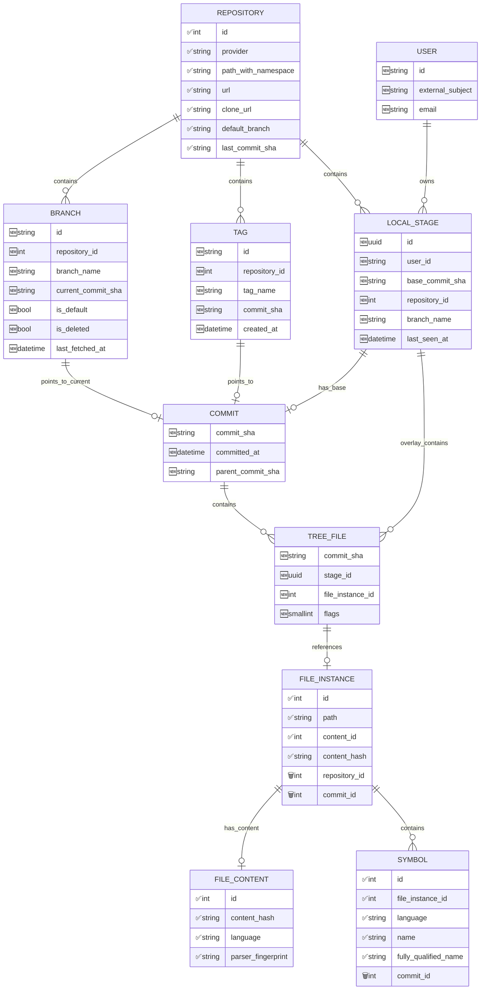

# Multi-Branch Brainstorm Baseline

Legend
- ✅ existing field in current schema
- 🆕 proposed field for discussion
- 🗑️ field to be removed/migrated

Schema source for existing fields: [`models.py`](axon-src/src/database/models.py)

## Approved Decisions

| Topic | Decision |
|-------|----------|
| Core model | COMMIT and LOCAL_STAGE as direct tree roots (no INDEX_TREE table) |
| COMMIT identity | commit_sha as primary key (globally unique, cross-repo sharing) |
| FILE_INSTANCE | Immutable, referenced via TREE_FILE junction |
| Branch storage | Separate BRANCH table pointing to COMMIT |
| Local changes | Base commit + mutable overlay pattern via TREE_FILE discriminator |
| Project | No PROJECT table - multi-repo projects handled client-side |
| TREE_FILE optimization | Remove path (redundant), flags field for tree_type+operation, nullable FKs |
| Reverse lookup | Keep full chain for semantic search (FILE_INSTANCE → COMMITS via index) |
| LOCAL_STAGE base | Commit-based (not branch/tag), client-generated UUID |
| LOCAL_STAGE repository_id | Informational only - for reverse lookup, can change without re-index |
| LOCAL_STAGE branch_name | Informational only - what client reports |
| LOCAL_STAGE TTL | Will have TTL, deferred to implementation |
| Delta compression | Commit-based: snapshots for active heads, deltas for historical commits |
| Delta direction | parent_commit_sha points to NEWER commit (replacement), not git parent |
| Delta type inference | parent_commit_sha=NULL → snapshot; parent_commit_sha set → delta |
| Delta resolution | First-match-wins: walk chain old→new, first entry per path wins |
| Delta conversion | Eager: convert old head to delta at branch advance time |
| Symbol dedup | Deferred - current model acceptable |

## ER Model: Simplified Tree Structure



## Entity Descriptions

### COMMIT
Repository-agnostic commit entity with delta compression support. Uses git SHA as primary key for cross-repo sharing.

| Field | Type | Description |
|-------|------|-------------|
| commit_sha | string(40) | Primary key (git SHA) |
| committed_at | datetime | Commit timestamp |
| parent_commit_sha | string(40) | FK to COMMIT - points to NEWER commit (replacement). NULL = snapshot |

**Delta Type Inference:**
- `parent_commit_sha = NULL` → **Snapshot** (has full TREE_FILE entries)
- `parent_commit_sha IS NOT NULL` → **Delta** (only changed files in TREE_FILE)

**Note:** `parent_commit_sha` points to the commit that replaced this one (newer in time), NOT the git parent. This enables walking the delta chain from old to new for resolution.

**Snapshot Sources:**
- Branch heads: `BRANCH.current_commit_sha`
- Stage bases: `LOCAL_STAGE.base_commit_sha`
- Tags: `TAG.commit_sha`

### TREE_FILE
Optimized junction table linking COMMIT or LOCAL_STAGE to FILE_INSTANCE. Uses nullable FKs and flags field.

| Field | Type | Description |
|-------|------|-------------|
| commit_sha | string(40) | FK to COMMIT (nullable - set for commit entries) |
| stage_id | uuid | FK to LOCAL_STAGE (nullable - set for stage entries) |
| file_instance_id | int | FK to FILE_INSTANCE (NOT NULL - path comes from FILE_INSTANCE) |
| flags | smallint | Encoded tree_type + operation (see below) |

**Primary Key:** (commit_sha, stage_id, file_instance_id) - exactly one of commit_sha/stage_id is set

**Indexes:**
- `idx_tree_files_instance` on (file_instance_id) - reverse lookup for semantic search
- `idx_tree_files_commit` on (commit_sha) WHERE commit_sha IS NOT NULL
- `idx_tree_files_stage` on (stage_id) WHERE stage_id IS NOT NULL

### TREE_FILE Flags Encoding

| Bits | Field | Values |
|------|-------|--------|
| 0-1 | tree_type | 0=commit, 1=stage |
| 2-3 | operation | 0=BASE, 1=ADD, 2=MODIFY, 3=DELETE |
| 4-15 | reserved | Future use |

**Examples:**
- `0x00` = commit, BASE
- `0x05` = stage, ADD (binary: 00000101)
- `0x0A` = stage, DELETE (binary: 00001010)

### TREE_FILE Discriminator Logic

| flags | commit_sha | stage_id | file_instance_id | Description |
|-------|------------|----------|------------------|-------------|
| 0x00 | ✅ set | NULL | set | Immutable file snapshot for a commit |
| 0x05 | NULL | ✅ set | set | New file in local stage (ADD) |
| 0x06 | NULL | ✅ set | set | Modified file in local stage (MODIFY) |
| 0x0A | NULL | ✅ set | set* | Deleted file (*may reference tombstone instance) |

**Storage Optimization:**
- Removed `id` - composite PK instead
- Removed `path` - get from FILE_INSTANCE.path
- Removed `tree_type` - encoded in flags
- Removed `operation` - encoded in flags
- Nullable FKs use ~0 bytes when NULL in PostgreSQL
- ~73% storage reduction vs original design

### LOCAL_STAGE
User's working context with commit-based root + overlay pattern. ID is client-generated for reproducibility.

| Field | Type | Description |
|-------|------|-------------|
| id | uuid | Primary key (client-generated, reproducible) |
| user_id | string | FK to USER |
| base_commit_sha | string(40) | FK to COMMIT (structural - defines tree root) |
| repository_id | int | FK to REPOSITORY (informational - for reverse lookup, can change) |
| branch_name | string | Informational - what branch client reports |
| last_seen_at | datetime | Last activity timestamp (for TTL cleanup) |

**Key Design Points:**
- `id` is client-generated UUID - allows reproducible reconnection to same stage
- `base_commit_sha` is structural - defines the immutable file tree base
- `repository_id` is informational - can change without re-indexing (client is authoritative for forward refs)
- `branch_name` is informational - what client thinks current branch is
- Client passes `(stage_id, repository_url, branch_name)` at query time
- Server uses `base_commit_sha` for file tree resolution

**Unique Key:** (user_id, id)

### BRANCH
First-class branch entity with mutable pointer to current commit.

| Field | Type | Description |
|-------|------|-------------|
| id | string | Primary key |
| repository_id | int | FK to REPOSITORY |
| branch_name | string | Branch name |
| current_commit_sha | string | FK to COMMIT (moves on advance) |
| is_default | bool | Is default branch |
| is_deleted | bool | Branch was deleted remotely |
| last_fetched_at | datetime | Last sync timestamp |

### TAG
Immutable tag pointing to COMMIT.

| Field | Type | Description |
|-------|------|-------------|
| id | string | Primary key |
| repository_id | int | FK to REPOSITORY |
| tag_name | string | Tag name |
| commit_sha | string | FK to COMMIT |
| created_at | datetime | Tag creation timestamp |

## Delta Compression

### Model Overview

When a branch advances from commit A → B:
1. **B becomes snapshot**: Full TREE_FILE entries (new head)
2. **A becomes delta**: Only changed files remain, reparent unchanged to B
3. **A.parent_commit_sha = B**: Points to replacement (not git parent)

### Delta Conversion at Branch Advance

```sql
-- Branch advance: A → B with changes
BEGIN;

-- 1. Reparent unchanged files: A → B
UPDATE tree_files 
SET commit_sha = 'B'
WHERE commit_sha = 'A' 
  AND file_instance_id NOT IN (SELECT file_instance_id FROM changes);

-- 2. Keep modified/deleted files in A (no change needed)
-- Their TREE_FILE entries remain pointing to A

-- 3. Insert DELETE entries in A for new files in B
-- (so A ignores files that didn't exist when it was head)
INSERT INTO tree_files (commit_sha, file_instance_id, flags)
SELECT 'A', fi.id, 0x0A  -- DELETE operation
FROM tree_files tf
JOIN file_instances fi ON tf.file_instance_id = fi.id
WHERE tf.commit_sha = 'B'
  AND NOT EXISTS (
      SELECT 1 FROM tree_files tf2 
      WHERE tf2.commit_sha = 'A' AND tf2.file_instance_id = tf.file_instance_id
  );

-- 4. Mark A as delta, pointing to B
UPDATE commits 
SET parent_commit_sha = 'B' 
WHERE commit_sha = 'A';

COMMIT;
```

### Delta Resolution: First-Match-Wins

To resolve files for a delta commit, walk chain from old to new, first entry per path wins:

```sql
-- Get files for commit A (delta chain: A → B → C where C is snapshot)
WITH RECURSIVE commit_chain AS (
    SELECT commit_sha, parent_commit_sha, 0 as depth
    FROM commits WHERE commit_sha = :target_commit
    UNION ALL
    SELECT c.commit_sha, c.parent_commit_sha, cc.depth + 1
    FROM commits c
    JOIN commit_chain cc ON c.commit_sha = cc.parent_commit_sha
    WHERE cc.parent_commit_sha IS NOT NULL
)
SELECT DISTINCT ON (fi.path)
    fi.path,
    tf.file_instance_id,
    tf.flags
FROM commit_chain cc
JOIN tree_files tf ON tf.commit_sha = cc.commit_sha
JOIN file_instances fi ON tf.file_instance_id = fi.id
WHERE (tf.flags & 0x0F) != 0x0A  -- Not DELETE
ORDER BY fi.path, cc.depth;  -- Lowest depth = first match wins
```

### Delta Chain Example

```
Time:   T1        T2        T3        T4
        ↓         ↓         ↓         ↓
        A ──────→ B ──────→ C ──────→ D
        delta     delta     delta     snapshot
        parent=D  parent=C  parent=B  parent=NULL

Branch head: D
Stage base: could be any of A, B, C, D

Resolution for A:
1. Get chain: A(depth=0) → B(depth=1) → C(depth=2) → D(depth=3)
2. Load all TREE_FILEs for A, B, C, D
3. Group by path, pick lowest depth entry
4. Filter out DELETE entries
```

### Storage Impact

| Scenario | Without Delta | With Delta |
|----------|---------------|------------|
| 100 commits, 10K files | 1M TREE_FILE rows | ~10K × 10 (active) + changes only |
| Branch with 90% unchanged files | 10K rows/commit | ~1K rows/commit (delta) |
| Estimated savings | - | ~80-90% for historical commits |

## Cross-Repository Commit Sharing

The same commit SHA can appear in multiple repositories:

```
Repository A (upstream):
  - main branch → commit abc123
  - feature branch → commit def456

Repository B (fork):
  - main branch → commit abc123 (same commit!)
  - feature branch → commit xyz789

COMMIT table:
  - abc123 (stored once, referenced by both repos)
  - def456
  - xyz789
```

This enables:
- **Storage deduplication**: One row per unique commit
- **Cross-repo analysis**: Trace commit propagation across forks
- **Efficient syncing**: Recognize already-indexed commits

## File Resolution for LOCAL_STAGE

Overlay resolution logic (path now comes from FILE_INSTANCE):

```sql
-- Get all files for a LOCAL_STAGE (base commit + overlay)
WITH base_files AS (
    SELECT tf.file_instance_id, fi.path, 0x00 as flags
    FROM tree_files tf
    JOIN file_instances fi ON tf.file_instance_id = fi.id
    WHERE tf.commit_sha = :base_commit_sha
),
overlay_files AS (
    SELECT tf.file_instance_id, fi.path, tf.flags
    FROM tree_files tf
    JOIN file_instances fi ON tf.file_instance_id = fi.id
    WHERE tf.stage_id = :local_stage_id
)
SELECT 
    COALESCE(of.path, bf.path) as path,
    COALESCE(of.file_instance_id, bf.file_instance_id) as file_instance_id,
    COALESCE(of.flags, 0x00) as flags
FROM base_files bf
LEFT JOIN overlay_files of ON bf.path = of.path
WHERE of.flags IS NULL OR (of.flags & 0x0F) != 0x0A  -- not DELETE
UNION
SELECT of.path, of.file_instance_id, of.flags
FROM overlay_files of
WHERE (of.flags & 0x0F) = 0x05  -- ADD
  AND of.path NOT IN (SELECT path FROM base_files);
```

## Semantic Search Path (Full Chain)

```sql
-- Find chunks in a specific branch with full chain
SELECT c.content, e.vector <=> :query_vector as distance
FROM embeddings e
JOIN chunks c ON e.chunk_id = c.id
JOIN file_contents fc ON c.file_content_id = fc.id
JOIN file_instances fi ON fi.current_content_id = fc.id
JOIN tree_files tf ON tf.file_instance_id = fi.id
JOIN commits cm ON tf.commit_sha = cm.sha
JOIN branches b ON b.current_commit_sha = cm.sha
WHERE b.name = :branch_name
ORDER BY distance;

-- Reverse: Find which commits contain a file_instance
SELECT cm.sha, b.branch_name, r.path_with_namespace
FROM tree_files tf
JOIN commits cm ON tf.commit_sha = cm.sha
JOIN branches b ON b.current_commit_sha = cm.sha
JOIN repositories r ON b.repository_id = r.id
WHERE tf.file_instance_id = :file_instance_id;
```

## Unique Keys

| Entity | Unique Key |
|--------|------------|
| USER | (external_subject) |
| REPOSITORY | (provider, path_with_namespace) |
| COMMIT | (commit_sha) - PK |
| BRANCH | (repository_id, branch_name) |
| TAG | (repository_id, tag_name) |
| LOCAL_STAGE | (user_id, id) - id is client-generated |
| FILE_INSTANCE | (path, content_hash) |
| TREE_FILE (commit) | (commit_sha, file_instance_id) |
| TREE_FILE (stage) | (stage_id, file_instance_id) |

## Migration Notes

Fields to remove from existing schema:
- FILE_INSTANCE.repository_id → now via TREE_FILE → COMMIT → BRANCH → REPOSITORY
- FILE_INSTANCE.commit_id → now via TREE_FILE.commit_sha
- SYMBOL.commit_id → SYMBOL always via FILE_INSTANCE

## Storage Comparison

| Metric | Before Optimization | After Optimization | Savings |
|--------|---------------------|-------------------|---------|
| TREE_FILE row size | ~232 bytes | ~62 bytes | 73% |
| 10K files per commit | ~2.3 MB | ~620 KB | 73% |
| 100 commits (10K files each) | ~230 MB | ~62 MB | 73% |

**Key optimizations:**
1. Removed `id` - use composite PK (commit_sha, stage_id, file_instance_id)
2. Removed `path` - get from FILE_INSTANCE.path (biggest saving: ~100B/row)
3. Removed `tree_type` - encoded in flags bits 0-1
4. Removed `operation` - encoded in flags bits 2-3
5. Nullable FKs (commit_sha/stage_id) use ~0 bytes when NULL in PostgreSQL

## Open Questions

1. **Symbol path dependency**: When FILE_INSTANCE path changes, SYMBOLs need recalculation. Copy-on-divergence handles this.
2. **Multi-repository projects**: Handled client-side - client tracks multiple repos, passes stage_ids at query time.
3. **DB reuse strategy**: FILE_CONTENT deduplication retained; COMMIT sharing across repos enabled. Topic 5 will cover SYMBOL/CHUNK dedup.
4. **Orphaned commits**: When branch advances, old commits become unreferenced. GC vs keep-forever? Deferred.
5. **Delta chain depth limit**: Very long chains could impact resolution performance. Consider periodic snapshot creation? Deferred.
