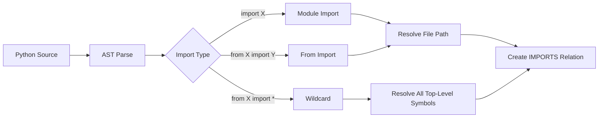
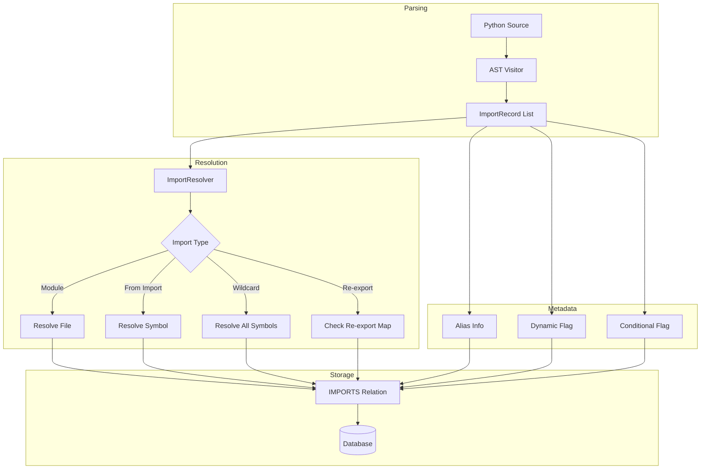

# Python Import Parsing Expansion Plan

## Overview

Expand Python import parsing to capture richer import metadata, handle edge cases, and improve symbol resolution accuracy.

## Current Implementation Analysis

### Files Involved

| File | Purpose | Current State |
|------|---------|---------------|
| [`import_resolver.py`](../axon-src/src/extractors/import_resolver.py) | Import extraction + resolution | Handles basic imports, from-imports, wildcards |
| [`python_parser.py`](../axon-src/src/parsers/python_parser.py) | AST parsing | Captures import strings, no metadata |
| [`path_resolver.py`](../axon-src/src/extractors/path_resolver.py) | Path resolution | Handles relative/absolute imports |

### Current Capabilities



### Current Gaps

| Gap | Impact | Priority |
|-----|--------|----------|
| No alias tracking | `import X as Y` loses alias | High |
| No structured import records | Limited query capability | Medium |
| No dynamic import detection | Missing `importlib` patterns | Medium |
| Limited `__init__.py` semantics | Re-exports not tracked | High |
| No conditional import handling | `try/except ImportError` skipped | Low |

---

## Proposed Enhancements

### 1. Alias Tracking

**Problem**: `import numpy as np` or `from collections import defaultdict as dd` - alias is lost.

**Solution**: Extend `ParsedSymbol` and import records to include alias metadata.

**Example**:
```python
# Input
import numpy as np
from collections import defaultdict as dd

# Current output
imports: ["numpy", "collections.defaultdict"]

# Proposed output
imports: [
    {"module": "numpy", "alias": "np", "symbols": []},
    {"module": "collections", "alias": None, "symbols": [{"name": "defaultdict", "alias": "dd"}]}
]
```

**Implementation**:
- Modify `_PythonAstVisitor.visit_Import` to capture `alias.asname`
- Modify `_PythonAstVisitor.visit_ImportFrom` to capture symbol aliases
- Update `PythonImportExtractionStrategy` to use structured records

### 2. Structured Import Records

**Problem**: Imports stored as flat strings, limiting query capability.

**Solution**: Define a structured `ImportRecord` dataclass.

**Proposed Schema**:
```python
@dataclass
class ImportRecord:
    module: str                    # Full module path
    level: int                     # Relative import level (0 = absolute)
    symbols: List[ImportedSymbol]  # Imported symbols (empty for module import)
    alias: Optional[str]           # Module alias (import X as Y)
    is_wildcard: bool              # from X import *
    line_number: int               # Source location
    is_conditional: bool           # Inside try/except ImportError

@dataclass
class ImportedSymbol:
    name: str                      # Original symbol name
    alias: Optional[str]           # Symbol alias (as Y)
```

**Storage**: Store in `ParseResult.imports` as structured records, serialize to JSON for database.

### 3. `__init__.py` Re-export Semantics

**Problem**: `from package import symbol` where symbol is re-exported in `__init__.py` is not resolved correctly.

**Example**:
```python
# package/__init__.py
from .module import MyClass  # Re-export

# other_file.py
from package import MyClass  # Should resolve to package.module.MyClass
```

**Solution**: Track re-exports in `__init__.py` files.

**Implementation**:
- When parsing `__init__.py`, mark `from .X import Y` as re-exports
- Store re-export mapping: `package -> package.module.MyClass`
- During import resolution, check re-export map for `from package import X`

### 4. Dynamic Import Detection

**Problem**: `importlib.import_module()` and `__import__()` are not captured.

**Example**:
```python
module = importlib.import_module("plugins." + plugin_name)
cls = __import__("module", fromlist=["ClassName"])
```

**Solution**: Parse dynamic import patterns as best-effort.

**Implementation**:
- Add `visit_Call` handler in `_PythonAstVisitor`
- Detect `importlib.import_module` and `__import__` calls
- Extract string literal arguments when possible
- Mark as dynamic import with `is_dynamic: True` flag

### 5. Conditional Import Handling

**Problem**: `try/except ImportError` blocks are parsed but not marked.

**Example**:
```python
try:
    import fastlib
except ImportError:
    import slowlib as fastlib
```

**Solution**: Track conditional import context.

**Implementation**:
- Track `try/except ImportError` context during AST walk
- Mark imports inside such blocks with `is_conditional: True`
- Store fallback chain when detectable

---

## Implementation Plan

### Phase 1: Structured Import Records

**Goal**: Replace flat string imports with structured records.

**Tasks**:
1. Define `ImportRecord` and `ImportedSymbol` dataclasses
2. Update `ParseResult` to use `List[ImportRecord]`
3. Modify `_PythonAstVisitor` to produce structured records
4. Update `PythonImportExtractionStrategy` to consume structured records
5. Add database migration if needed for metadata storage

**Validation**:
- Unit tests for each import pattern
- Integration test with real Python codebase
- Verify IMPORTS relations still created correctly

### Phase 2: Alias Tracking

**Goal**: Capture and use alias information.

**Tasks**:
1. Extend `ImportRecord` with alias fields
2. Update AST visitor to capture `asname`
3. Store alias in relation metadata
4. Update symbol resolution to consider aliases

**Validation**:
- Test: `import numpy as np` creates alias metadata
- Test: `from X import Y as Z` creates symbol alias
- Verify retrieval queries can use alias info

### Phase 3: `__init__.py` Re-exports

**Goal**: Resolve re-exported symbols correctly.

**Tasks**:
1. Detect `__init__.py` files during parsing
2. Mark `from .X import Y` as re-exports
3. Build re-export map per package
4. Update import resolution to check re-export map

**Validation**:
- Test: `from package import symbol` resolves to actual source
- Integration test with package structure

### Phase 4: Dynamic Imports

**Goal**: Capture dynamic import patterns.

**Tasks**:
1. Add `visit_Call` handler for `importlib.import_module`
2. Add handler for `__import__`
3. Mark dynamic imports with flag
4. Best-effort resolution for literal arguments

**Validation**:
- Test: `importlib.import_module("X")` captured
- Test: Dynamic imports marked correctly

---

## Architecture Diagram



---

## Data Model Changes

### ImportRecord Storage

Store in `Relation.relation_metadata`:

```json
{
  "import_path": "numpy",
  "alias": "np",
  "file_id": 123,
  "symbols": [],
  "is_wildcard": false,
  "is_dynamic": false,
  "is_conditional": false,
  "line_number": 5
}
```

### Re-export Map Storage

New table or in-memory cache:

```sql
-- Option 1: New table
CREATE TABLE reexport_map (
    id SERIAL PRIMARY KEY,
    package_file_id INTEGER REFERENCES file_instance(id),
    exported_name VARCHAR(255),
    source_file_id INTEGER REFERENCES file_instance(id),
    source_symbol_id INTEGER REFERENCES symbol(id)
);

-- Option 2: Store in repository metadata
-- JSON field in repository table
```

---

## Testing Strategy

### Unit Tests

| Test Case | Input | Expected Output |
|-----------|-------|-----------------|
| Basic import | `import os` | `ImportRecord(module="os")` |
| Aliased import | `import numpy as np` | `ImportRecord(module="numpy", alias="np")` |
| From import | `from os import path` | `ImportRecord(module="os", symbols=[{name: "path"}])` |
| Aliased from | `from os import path as p` | `ImportRecord(module="os", symbols=[{name: "path", alias: "p"}])` |
| Wildcard | `from os import *` | `ImportRecord(module="os", is_wildcard=True)` |
| Relative | `from . import module` | `ImportRecord(module="", level=1)` |
| Relative named | `from ..pkg import X` | `ImportRecord(module="pkg", level=2)` |
| Dynamic | `importlib.import_module("X")` | `ImportRecord(module="X", is_dynamic=True)` |
| Conditional | `try: import X except: import Y` | Both marked `is_conditional=True` |

### Integration Tests

1. Parse real Python package with complex imports
2. Verify IMPORTS relations created correctly
3. Verify alias metadata queryable
4. Verify re-export resolution works

---

## Risk Assessment

| Risk | Likelihood | Impact | Mitigation |
|------|------------|--------|------------|
| Breaking existing import resolution | Medium | High | Comprehensive test coverage, backward-compatible changes |
| Performance impact from structured records | Low | Medium | Benchmark before/after |
| Re-export map complexity | Medium | Medium | Start with simple cases, iterate |
| Dynamic import false positives | Medium | Low | Conservative detection, mark as dynamic |

---

## Success Criteria

1. **Alias tracking**: All import aliases captured and queryable
2. **Structured records**: Import metadata available in database
3. **Re-export resolution**: `from package import X` resolves correctly when X is re-exported
4. **Dynamic detection**: `importlib.import_module` patterns captured
5. **Backward compatibility**: Existing IMPORTS relations still work
6. **Test coverage**: All import patterns have unit tests

---

## Estimated Effort

| Phase | Complexity |
|-------|------------|
| Phase 1: Structured Records | Medium |
| Phase 2: Alias Tracking | Low |
| Phase 3: Re-exports | Medium-High |
| Phase 4: Dynamic Imports | Low-Medium |

**Recommendation**: Implement phases 1-2 first (foundation), then phase 3 (high value), phase 4 optional.

---

## Next Steps

1. Review and approve this plan
2. Create detailed implementation tickets for Phase 1
3. Begin with `ImportRecord` dataclass definition
